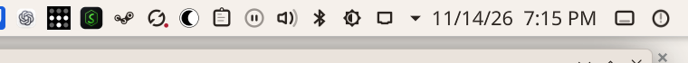
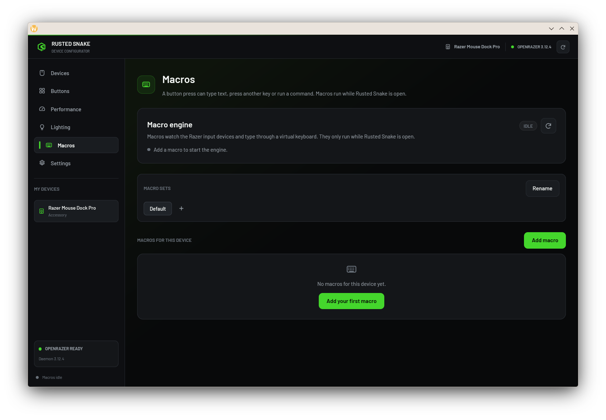

# Rusted Snake

A modern Linux configurator for Razer devices, rewritten from scratch in Rust with
[GPUI](https://gpui.rs). It talks to devices through [OpenRazer](https://openrazer.github.io/)
and to the mouse's own memory over raw HID.

This is a fork of [Snake by Brett Smith](https://github.com/bithatch/snake), continuing
the work of [ScoobyDouche/snake](https://github.com/ScoobyDouche/snake), reimplemented as
a native Rust application. It targets OpenRazer 3.12 and a Razer Naga Trinity, and is
designed to work with anything OpenRazer supports.


## What it does

- **One window, built with GPUI.** A dark Razer Synapse-style interface: a device rail,
  live status, cards, chips and neon-green accents. Everything is drawn by GPUI; there is
  no web view, Java or Electron.
- **Devices.** Live device discovery through OpenRazer with model, firmware, serial,
  battery, DPI, polling rate and lighting status.
- **Buttons and onboard profiles.** Read, edit and save the mouse's own profiles: which
  button does what (key, mouse button, DPI up/down, next profile or off), side plate
  selection for the Naga Trinity, and per-profile lighting. Profiles keep working on any
  computer without Rusted Snake.
- **Performance.** DPI stages stored on the mouse, or a live DPI slider and polling-rate
  control through OpenRazer for devices without onboard profiles.
- **Lighting.** Overall and per-zone brightness, static colours, spectrum, breath,
  reactive, wave, starlight, pulsate, ripple and the other effects your device exposes.
  A custom HSV colour picker and quick swatches are included.
- **Software effects.** Spectrum, breath and audio-reactive effects for devices that only
  accept static colours. Audio follows your choice of PipeWire/PulseAudio source; the
  default follows what is playing.
- **Macros.** Per-device macros that press a key, type text or run a command, grouped in
  sets. They run while Rusted Snake is open and are triggered by the side buttons.
- **Backups.** Every profile is backed up before the first write. Back up and restore all
  profiles from Settings; backups are compatible with Snake's JSON format.
- **Settings.** Experimental saving for untested mice, startup with the computer,
  raw-HID and macro permission instructions, daemon diagnostics.
- **Tray icon.** A StatusNotifierItem tray icon with Show, page shortcuts and Quit. On X11,
  closing the window keeps Rusted Snake in the tray; on Wayland it quits because GPUI cannot
  restore a minimized window.
- **Startup and updates.** `bin/rusted-snake` builds on first run, fast-forwards from git
  when the checkout is clean, and starts the release binary.


The custom colour picker uses hue, saturation and brightness with a live preview:


The tray icon uses the StatusNotifierItem protocol and offers page shortcuts and Quit:



## Requirements

- Linux with Wayland or X11 and a Vulkan-capable GPU (GPUI uses Vulkan).
- [OpenRazer](https://openrazer.github.io/) installed with `openrazer-daemon` running and
  your user in the `openrazer` group.
- Rust 1.90 or newer, with `cargo`.
- Build dependencies for GPUI:
  - Arch: `base-devel clang pkgconf wayland libxkbcommon vulkan-icd-loader vulkan-headers fontconfig freetype2`
  - Debian/Ubuntu: `build-essential clang pkg-config libwayland-dev libxkbcommon-dev libvulkan-dev libfontconfig1-dev libfreetype6-dev libx11-dev libxcb1-dev`
- PipeWire or PulseAudio for the Audio lighting effect (`parec`, `pactl`). On Debian/Ubuntu install `pulseaudio-utils`; on Arch `libpulse` provides `parec`.
- For onboard profiles: access to the mouse's raw HID node (udev rule below).
- For macros: read access to Razer input devices and access to `/dev/uinput`.

## Build and run

```sh
git clone https://github.com/henrychea/rusted_snake.git ~/rusted_snake
cd ~/rusted_snake
cargo build --release -p rusted-snake
./target/release/rusted-snake
```

Or let the launcher build and run it:

```sh
~/rusted_snake/bin/rusted-snake
```

The launcher logs to `${XDG_CACHE_HOME:-~/.cache}/rusted-snake/launcher.log`. Set
`RUSTED_SNAKE_UPDATE=0` to skip the git update check. Pass `--page lighting` (or
`devices`, `buttons`, `performance`, `macros`, `settings`) to open a page directly.

### Desktop integration

```sh
install -Dm755 target/release/rusted-snake ~/.local/bin/rusted-snake
install -Dm644 linux/rusted-snake.desktop ~/.local/share/applications/rusted-snake.desktop
install -Dm644 assets/icon/rusted-snake.svg ~/.local/share/icons/hicolor/scalable/apps/rusted-snake.svg
install -Dm644 assets/icon/rusted-snake.png ~/.local/share/icons/hicolor/256x256/apps/rusted-snake.png
update-desktop-database ~/.local/share/applications 2>/dev/null || true
```

Then start **Rusted Snake** from your app menu, or turn on **Startup** in Settings.

## Permissions

### Onboard profiles (raw HID)

Savings button maps, DPI stages and lighting to the mouse needs raw HID access:

```sh
sudo cp linux/70-rusted-snake-hidraw.rules /etc/udev/rules.d/
sudo udevadm control --reload-rules && sudo udevadm trigger
```

The rule grants the signed-in seat user access to Razer hidraw nodes. Unplug and replug
the mouse if the node already existed.

### Macros (input devices and uinput)

```sh
sudo cp linux/99-rusted-snake-uinput.rules /etc/udev/rules.d/
sudo udevadm control --reload-rules && sudo udevadm trigger
sudo usermod -aG input "$USER"
```

Sign out and back in after changing groups. Rusted Snake only grabs Razer input devices
when at least one macro exists, and forwards normal input through a virtual keyboard, so
the mouse and keyboard keep working. Closing the app releases the devices and stops the
macros.

## Using Rusted Snake

- **Devices** lists what OpenRazer sees. Pick a device, then open Buttons, Performance or
  Lighting.
- **Buttons** reads the profiles stored in the mouse. Pick a profile slot and side plate,
  click a numbered marker or button card, choose what it should do and save it to the
  mouse. Left click is intentionally not editable.
- **Performance** edits the DPI stages for the selected onboard profile, or the live
  sensor/polling rate through OpenRazer. Polling rate changes are applied immediately.
- **Lighting** controls brightness and each zone's hardware effect. The custom colour
  dialog has hue, saturation and value sliders, a hex readout and presets. **Live effects**
  animate the device while Rusted Snake is open; **Saved lighting** returns to the
  profile's own colours. Save onboard lighting with the button at the bottom.
- **Macros** manages macro sets. A macro is a trigger plus an action: press a key, type
  text, or run a shell command. Repeat modes are Once, while held, and toggle.
- **Settings** has the experimental-write switch, backups/restore, startup, access
  instructions, OpenRazer diagnostics and the about panel.
- **Keyboard:** Ctrl+1…6 switch pages, F11 toggles full screen, Esc closes an editor or
  colour dialog, and Ctrl+Q quits.



## Profiles and backups

Mice with onboard memory keep button maps, DPI stages and lighting per profile. Slot 0 is
the live state; slots 1..5 are stored profiles. Rusted Snake reads and writes the same
format as Synapse for supported models.

Before the first write to a mouse, Rusted Snake saves every profile to
`${XDG_DATA_HOME:-~/.local/share}/rusted-snake/backups/`. The same folder is used by
**Back up now** and the restore list in Settings. Saving to untested models stays off
unless **Experimental saving** is enabled; only the Naga Trinity is verified.

## Architecture

```
crates/
  rusted-snake-core      domain model, settings, macros, onboard backup format, key maps
  rusted-snake-backend   OpenRazer DBus client, raw HID protocol, worker service,
                         software lighting engine, audio capture, evdev/uinput macros
  rusted-snake-ui        GPUI theme, widgets and pages
  rusted-snake           application entry point
assets/                  Barlow fonts, mouse artwork, icons, app icon
linux/                   udev rules and desktop entry
vendor/xattr             upstream xattr 0.2.3 with a one-line libc fix (see its README)
```

The backend owns a thread with a blocking DBus connection and a command/event channel.
The GPUI entity polls events on a timer, so device calls never block rendering. Software
effects run in the backend at 20 fps and write static colours through OpenRazer. Macros
grab Razer input devices with evdev and inject through a uinput virtual keyboard.

## Notes and limits

- The tray icon needs a StatusNotifier host (KDE Plasma, Cinnamon, or GNOME with the
  AppIndicator extension). On Wayland, GPUI cannot unminimize a window from the tray, so
  closing the window quits the app; the tray is available while the window is open. On X11,
  closing minimizes to the tray and the tray's Show item restores it. Live effects and
  macros stop when the app quits.
- The audio effect applies colours to lighting zones. It does not draw a per-key matrix
  animation on keyboards.
- Per-app macro lists and macro recording, which earlier Snake versions had, are not part
  of this rewrite.
- The in-app updater is replaced by the launcher's git fast-forward. Updates are not
  installed from inside the window.
- Onboard writes are verified and read back. Unknown models use read-only probing until
  Experimental saving is explicitly enabled.

## License

GNU General Public License v3.0, like the original Snake. See [LICENSE](LICENSE).

Original Snake copyright Brett Smith and contributors. Rusted Snake is maintained by
Henry Chea. Razer, Naga and Synapse are trademarks of Razer Inc.; this project is not
affiliated with Razer. The bundled Barlow fonts are under the SIL Open Font License (see
`assets/fonts/OFL.txt`). GPUI is licensed under Apache-2.0 by Zed Industries.
