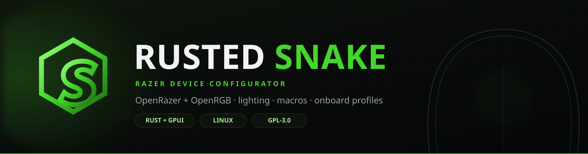
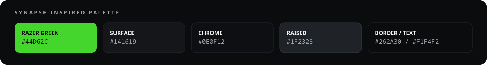
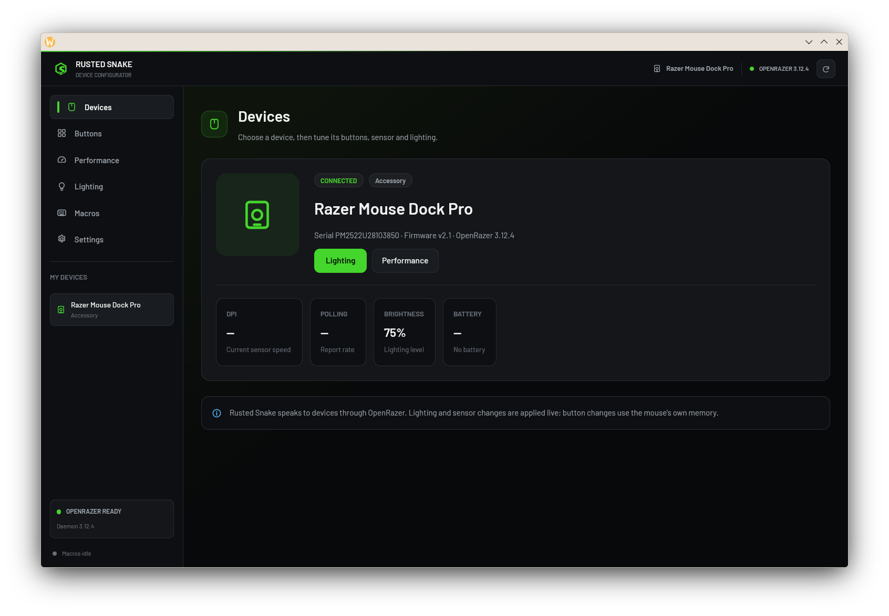
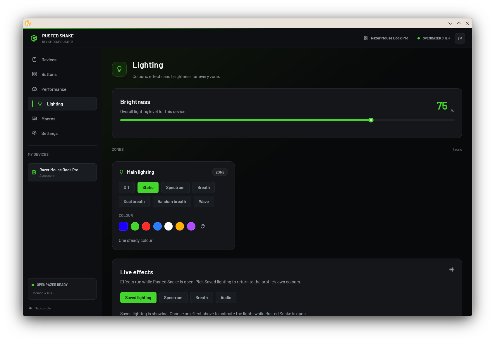
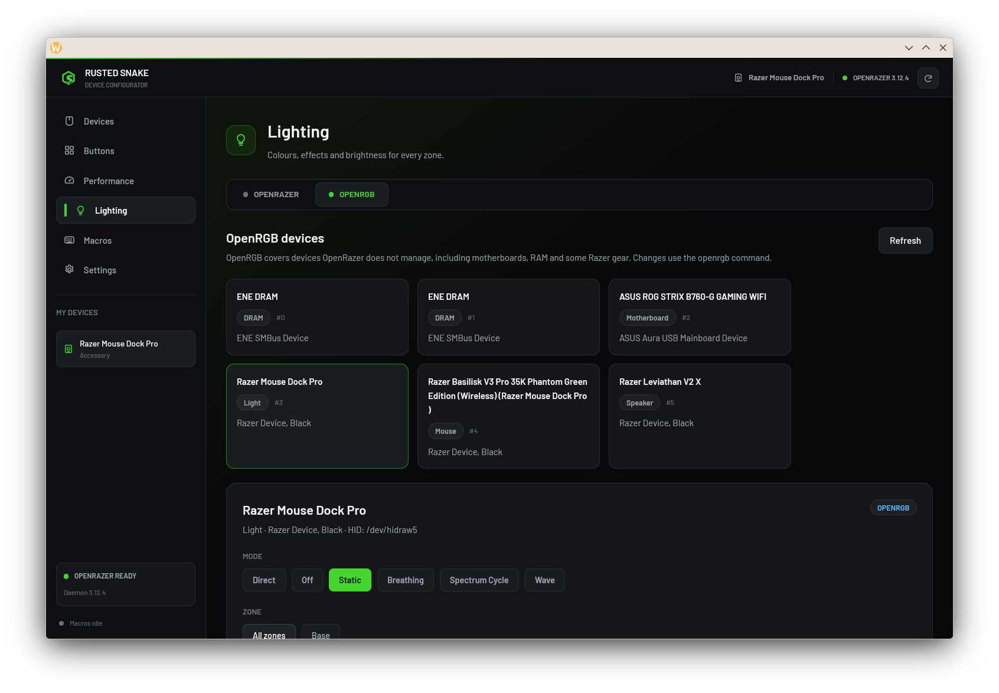
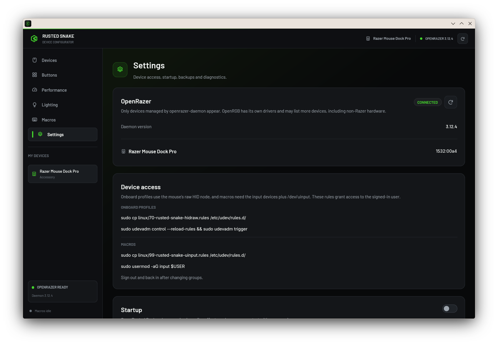
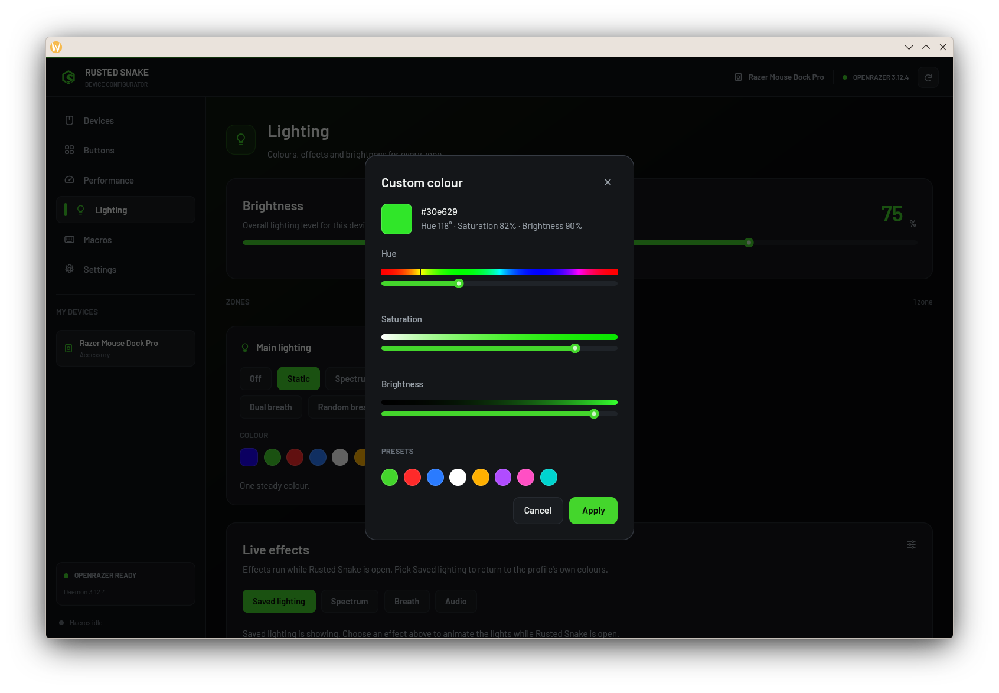

<div align="center">
  
</div>

<h1 align="center">RUSTED SNAKE</h1>

<p align="center">
  <strong>Razer Synapse energy. Linux soul. Native Rust + GPUI.</strong><br>
  Configure Razer hardware through OpenRazer — or reach past it with OpenRGB.
</p>

<p align="center">
  <a href="https://github.com/henrychea/rusted_snake"></a>
  <a href="https://www.rust-lang.org/"></a>
  <a href="https://gpui.rs/"></a>
  <a href="https://openrazer.github.io/"></a>
  <a href="LICENSE"></a>
  <a href="https://github.com/henrychea/rusted_snake/stargazers"></a>
</p>

<p align="center">
  <a href="#quick-start">Quick start</a> ·
  <a href="#install">Install</a> ·
  <a href="#device-support">Device support</a> ·
  <a href="#screenshots">Screenshots</a> ·
  <a href="#how-it-works">How it works</a> ·
  <a href="#copyright--license">License</a>
</p>

---

## ▍ Why Rusted Snake

Razer's hardware is great. Its software story on Linux is not. Rusted Snake is a native
configurator that feels like a modern Synapse window without the web runtime, the account,
the cloud, or the Java.

- **One GPU-accelerated window.** Everything is GPUI: layout, painting, sliders, colour
  picker, hover states, tray-driven window recreation.
- **OpenRazer first.** Live devices, lighting zones, DPI, polling rate, battery, onboard
  profiles, backups and macros.
- **OpenRGB when OpenRazer cannot see it.** A second Lighting tab controls motherboards,
  DRAM, speakers and the Razer devices OpenRazer misses.
- **Your settings stay yours.** No telemetry, no account, no network calls. Local JSON
  settings and macros; profiles live in the mouse.
- **One process, no ghost windows.** Close to tray destroys the window and keeps effects and
  macros alive in the tray, Bitwarden-style.

## ▍ The theme

<div align="center">
  
</div>

Razor-sharp charcoal, neon green, quiet borders, and generous spacing. The goal is a
**Synapse-inspired Linux application**, not a skin on top of a web page: Barlow type,
custom-drawn mouse art, per-zone lighting cards, a device rail, and a green accent used like
a signal — never wallpaper.

- **Razer Green** `#44D62C` — active states, sliders, status, focus.
- **Chrome** `#0E0F12`, **surface** `#141619`, **raised** `#1F2328`.
- **Borders** `#262A30`, **text** `#F1F4F2`, **muted** `#9BA3AB`.
- Rounded 8–14 px surfaces, 1 px borders, soft glow on the logo and selected zones.

<a id="screenshots"></a>
## ▍ Screenshots

<table>
  <tr>
    <td width="50%" align="center"><br><sub><strong>Devices</strong> — live OpenRazer inventory</sub></td>
    <td width="50%" align="center"><br><sub><strong>Lighting</strong> — zones, effects, brightness</sub></td>
  </tr>
  <tr>
    <td width="50%" align="center"><br><sub><strong>OpenRGB</strong> — hardware OpenRazer misses</sub></td>
    <td width="50%" align="center"><br><sub><strong>Macros</strong> — key, text, command</sub></td>
  </tr>
  <tr>
    <td width="50%" align="center"><br><sub><strong>Settings</strong> — access, backups, tray</sub></td>
    <td width="50%" align="center"><br><sub><strong>Colour picker</strong> — hue / saturation / value</sub></td>
  </tr>
</table>

## ▍ Feature set

<table>
  <tr>
    <td width="50%"><strong>Devices</strong><br>Live OpenRazer discovery with model, firmware, serial, VID:PID, battery, DPI, polling rate and lighting status.</td>
    <td width="50%"><strong>Buttons</strong><br>Onboard profile slots, Naga side plates, clickable mouse markers, and a button editor that writes to the mouse and reads the result back.</td>
  </tr>
  <tr>
    <td><strong>Performance</strong><br>Onboard DPI stages with an active stage, or a live DPI and polling-rate control through OpenRazer.</td>
    <td><strong>Lighting</strong><br>Overall and per-zone brightness, static, spectrum, breath, reactive, wave, starlight, pulsate, ripple, plus a custom HSV picker.</td>
  </tr>
  <tr>
    <td><strong>Live effects</strong><br>Software spectrum, breath and audio-reactive lighting for devices that only accept static colours. Runs while Rusted Snake is running, including when hidden to tray.</td>
    <td><strong>Macros</strong><br>Per-device macro sets: press a key, type text or run a command. Once, while held, or toggle. Triggered through evdev and injected through uinput.</td>
  </tr>
  <tr>
    <td><strong>OpenRGB</strong><br>Switch the Lighting page to OpenRGB for boards, RAM, speakers and Razer gear that OpenRazer does not manage. Modes, zones, colours, brightness, speed.</td>
    <td><strong>Tray</strong><br>StatusNotifierItem with Show, page shortcuts and Quit. Close to tray removes the window from the taskbar and window switcher; Show rebuilds it.</td>
  </tr>
</table>

<a id="quick-start"></a>
## ▍ Quick start

**Requirements**

- Linux with Wayland or X11 and a Vulkan-capable GPU.
- [OpenRazer](https://openrazer.github.io/) with `openrazer-daemon` running and your user in
  the `openrazer` group.
- Rust 1.90+ with Cargo.
- GPUI build dependencies:
  - Arch: `base-devel clang pkgconf wayland libxkbcommon vulkan-icd-loader vulkan-headers fontconfig freetype2`
  - Debian/Ubuntu: `build-essential clang pkg-config libwayland-dev libxkbcommon-dev libvulkan-dev libfontconfig1-dev libfreetype6-dev libx11-dev libxcb1-dev`
- PipeWire or PulseAudio for the audio effect (`parec`, `pactl`). On Arch, `libpulse`
  provides `parec`; on Debian/Ubuntu install `pulseaudio-utils`.
- Optional: [OpenRGB](https://openrgb.org/) for the OpenRGB lighting tab; the `openrgb`
  command must be on `PATH`.

```sh
git clone https://github.com/henrychea/rusted_snake.git ~/rusted_snake
cd ~/rusted_snake
cargo build --release -p rusted-snake
./target/release/rusted-snake
```

Or let the launcher build, update from git, and run:

```sh
~/rusted_snake/bin/rusted-snake
```

The launcher logs to `${XDG_CACHE_HOME:-~/.cache}/rusted-snake/launcher.log`. Set
`RUSTED_SNAKE_UPDATE=0` to skip the git check. `--page lighting` opens a page directly.

<a id="install"></a>
## ▍ Install

The desktop installer builds the release binary and installs the app menu entry, icons and
optional permissions:

```sh
cd ~/rusted_snake
./install.sh                 # ~/.local
./install.sh --system        # /usr/local (sudo when needed)
./install.sh --with-udev     # add raw-HID and uinput rules
./install.sh --no-build      # install the existing release binary
./install.sh --uninstall     # remove binary, entry and icons
./install.sh --prefix=/opt   # custom prefix
```

Installed paths:

- `~/.local/bin/rusted-snake`
- `~/.local/share/applications/com.henrychea.RustedSnake.desktop`
- `~/.local/share/icons/hicolor/{32x32,48x48,64x64,128x128,256x256,512x512,scalable}/apps/rusted-snake.*`

The desktop entry uses the same application ID as the Wayland window
(`com.henrychea.RustedSnake`) and an absolute `Exec` path, so panel grouping works and
`~/.local/bin` does not need to be in `PATH`.

### Permissions

**Onboard profiles (raw HID)**

```sh
sudo cp linux/70-rusted-snake-hidraw.rules /etc/udev/rules.d/
sudo udevadm control --reload-rules && sudo udevadm trigger
```

**Macros (input devices and uinput)**

```sh
sudo cp linux/99-rusted-snake-uinput.rules /etc/udev/rules.d/
sudo udevadm control --reload-rules && sudo udevadm trigger
sudo usermod -aG input "$USER"
```

Sign out and back in after changing groups. Unplug and replug a mouse if its hidraw node
already existed before the rule was installed. `./install.sh --with-udev` does the rule
installation for you.

<a id="device-support"></a>
## ▍ Device support

OpenRazer is the source of truth for discovery. Rusted Snake lists every device returned by
`org.razer.getDevices` and builds controls from the interfaces and methods found by
introspection.

| Feature | Coverage |
| --- | --- |
| Device list, name, firmware, serial, battery | Any device exposing `razer.device.misc` / `razer.device.power` |
| Brightness and lighting | `chroma`, `logo`, `scroll`, `left`, `right`, `backlight` and legacy `bw2013` zones. Prefixed setters (`setLogoStatic`, `setScrollSpectrum`, …) are handled. Effects appear only when the daemon exposes them |
| DPI and polling | `razer.device.dpi` and poll-rate methods. Polling choices: 125, 500, 1000, 2000, 4000, 8000 Hz |
| Onboard buttons and profiles | Raw HID. Naga Trinity (1532:0067) is verified; other Razer mice are probed read-only and need Experimental saving. Keyboard onboard profiles are not handled |
| Macros | Any Razer evdev keyboard or mouse; trigger list defaults to Naga side buttons plus key capture. Broadly tested with a mouse |
| Audio-reactive lighting | At least one static-capable zone; colours are per-zone, not per-key |
| OpenRGB tab | Any controller the `openrgb` command lists, including non-Razer hardware; lighting modes/zones/colour/brightness/speed only |

OpenRazer's `razer.device.binding` and `razer.device.macro` interfaces are not used, so
keyboard button remapping and OpenRazer's macro recording are not part of this rewrite.
OpenRGB is a separate stack with its own drivers; the **Lighting → OpenRGB** tab invokes the
`openrgb` CLI and does not link its client library. Other pages remain OpenRazer-only.

<a id="how-it-works"></a>
## ▍ How it works

```text
crates/
  rusted-snake-core      domain model, settings, macros, onboard backup format, key maps
  rusted-snake-backend   OpenRazer DBus, raw HID protocol, worker service,
                         software lighting, audio capture, evdev/uinput macros,
                         OpenRGB command bridge
  rusted-snake-ui        GPUI theme, widgets, pages, tray and window runtime
  rusted-snake           application entry point
assets/                  Barlow fonts, mouse art, icons, README artwork
linux/                   udev rules and desktop entry
install.sh               user/system installer
vendor/gpui              GPUI 0.2.2 with a Linux tray event-loop patch
vendor/xattr             xattr 0.2.3 with a libc compatibility patch
```

The backend and tray service live in an app-level runtime. Closing to tray destroys the
visible window, pauses UI events, and keeps effects and macros running; the tray task
recreates the window on demand. The vendored GPUI patch keeps the Linux event loop alive
with zero windows and still stops on explicit Quit. Software effects run at 20 fps and write
static colours through OpenRazer. Macros grab Razer input devices and inject through uinput.

## ▍ Notes and limits

- **Close to tray** is opt-in (Settings → Window) and needs a StatusNotifier host: KDE
  Plasma, Cinnamon, or GNOME with AppIndicator. With it enabled, the window leaves the
  taskbar and switcher; `Show` rebuilds it at the last page. With it off, closing quits.
- Tray Quit or **Ctrl+Q** exits completely.
- No tray icon where no StatusNotifier host exists.
- No in-app updater. `bin/rusted-snake` fast-forwards from git and rebuilds; the installed
  binary does not update itself.
- The OpenRGB tab is a command-line bridge, not an SDK client. Each change costs roughly a
  second and it applies static controls, not live software effects.
- Audio lighting is per-zone, not a per-key matrix animation.
- Per-app macro lists, macro recording and the old layout designer are not part of this
  rewrite.
- Unsaved window state (a macro draft, an open colour picker) is lost when the window is
  hidden and rebuilt; saved settings, macros and profiles persist.

<a id="copyright--license"></a>
## ▍ Copyright & license

Rusted Snake is **free software** under the **GNU General Public License v3.0**.
See [LICENSE](LICENSE) and the full attribution list in [NOTICE.md](NOTICE.md).

| Work | Copyright | License |
| --- | --- | --- |
| Rusted Snake rewrite, UI, artwork | © 2026 Henry Chea | GPL-3.0-only |
| Snake (original) | © 2020–2021 Brett Smith and contributors | GPL-3.0 |
| ScoobyDouche/snake (Linux fork) | © 2026 ScoobyDouche and contributors | GPL-3.0 |
| GPUI 0.2.2 | © Zed Industries and contributors | Apache-2.0 |
| Barlow fonts | © 2017 The Barlow Project Authors | SIL OFL 1.1 |
| xattr 0.2.3 | © Steven Allen | MIT OR Apache-2.0 |
| ksni | © iovxw | Unlicense |

OpenRazer, OpenRGB and PipeWire/PulseAudio are external programs with their own authors and
licenses. Their code is not bundled.

Razer, Razer Synapse, Razer Chroma, Naga and related marks are trademarks or registered
trademarks of Razer Inc. This is an independent community project and is **not affiliated
with, endorsed by, or sponsored by Razer Inc.**

<p align="center"><sub>Built with Rust + GPUI · no account · no telemetry · no Synapse required</sub></p>
